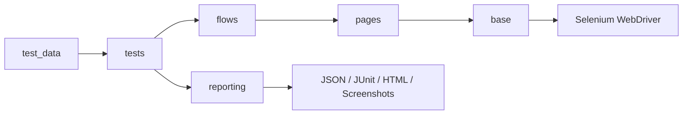

# SauceDemo UI 自动化测试

[](https://github.com/yanamitt/Selenium-saucedemo-ui-automation-/actions/workflows/ui-tests.yml)
[](LICENSE)

本项目基于 **Python + Selenium + Pytest**，使用 Page Object Model 组织 SauceDemo 电商站点的 UI 自动化测试。目标是展示一套可维护、可诊断、可在 CI 中跨浏览器运行的 Web UI 自动化测试框架，而不只是若干能够执行的测试脚本。

项目覆盖登录、商品排序、购物车、结账校验和核心下单流程，并输出 JSON、JUnit XML、HTML 报告、失败日志与截图，为后续测试结果数据分析提供稳定输入。

## 技术栈

- Python 3.12
- Selenium WebDriver
- Pytest
- Pytest-HTML
- Page Object Model

## 项目结构

```text
base/                 # 页面对象基类，封装等待、点击、输入、读取文本
pages/                # 具体页面对象
flows/                # 登录和购物业务流程，只负责编排操作与采集实际结果
test_data/            # 不可变的账号、结算信息、参数化案例和预期结果
reporting/            # 运行批次、元数据和结构化测试结果
scripts/              # 标准测试运行入口
tests/                # Pytest 测试用例
docs/samples/          # 经过敏感信息扫描的固定报告示例
.github/               # GitHub Actions 和 Dependabot 配置
conftest.py           # 浏览器 fixture、失败截图、失败日志、HTML 报告增强
settings.py           # BASE_URL、BROWSER、HEADLESS、SELENIUM_TIMEOUT 配置
pytest.ini            # Pytest 默认运行参数
requirements.txt      # 项目最小依赖
artifacts/            # 按 run_id 隔离的测试产物（运行后生成）
```

## 分层职责

- `pages/` 只封装页面元素和单页面操作。
- `flows/` 组合多个 Page Object 完成业务流程，不包含测试断言。
- `test_data/` 集中保存输入数据和预期结果，测试文件不再硬编码账号和文案。
- `tests/` 调用业务流程并负责最终断言，使“怎么操作”和“验证什么”保持分离。



## 覆盖场景

| 模块 | 用例 | 关键断言 |
| --- | --- | --- |
| 登录 | 标准用户登录成功 | 校验 Inventory URL 和页面标题 |
| 登录 | 锁定、错误密码、空字段、未知用户等 6 种失败输入 | 校验每种输入对应的错误文案 |
| Inventory | 名称和价格的 4 种排序方式 | 校验商品列表按指定方向排序 |
| 购物车 | Backpack 加购后移除 | 校验 badge 数量及移除状态 |
| Checkout | 名字、姓氏、邮编必填校验 | 校验停留页面和对应错误文案 |
| 购物流程 | 登录、加购、购物车、结算、完成订单 | 校验页面跳转、商品名称、价格、购物车数量和完成订单文案 |

## 当前验证状态

以下结果于 2026-07-16 在发布准备工作区使用 Python 3.12、Edge Headless 验证：

| 测试层级 | 数量 | 结果 |
| --- | ---: | --- |
| 单元测试 | 84 | 84 Passed |
| Web UI Regression | 16 | 16 Passed |
| 完整测试集 | 100 | 100 Passed |

本地结果只证明 Edge 环境通过。Chrome 和 Firefox 的真实结果以首次 Pull Request 的 GitHub Actions 三浏览器矩阵为准，不把尚未执行的环境描述为已验证。

## 快速开始

```powershell
python -m venv .venv
.\.venv\Scripts\Activate.ps1
python -m pip install -r requirements.txt
python scripts/run_tests.py
```

只运行登录失败用例：

```powershell
python scripts/run_tests.py tests/test_login.py -q
```

只运行端到端购物流程：

```powershell
python scripts/run_tests.py tests/test_e2e_flow.py -q
```

按测试层级或业务模块运行：

```powershell
python scripts/run_tests.py -m smoke
python scripts/run_tests.py -m "regression and checkout"
```

可用标记包括 `smoke`、`regression`、`login`、`inventory`、`cart`、`checkout` 和 `e2e`。这些标记也会写入结构化结果，便于按模块分析测试质量。

## 运行配置

| 环境变量 | 默认值 | 说明 |
| --- | --- | --- |
| `BASE_URL` | `https://www.saucedemo.com/` | 被测站点地址 |
| `BROWSER` | `edge` | 支持 `edge`、`chrome`、`firefox` |
| `HEADLESS` | `false` | 设置为 `true` 后使用无头浏览器 |
| `SELENIUM_TIMEOUT` | `10` | 显式等待超时时间，单位秒 |

示例：

```powershell
$env:BROWSER = "chrome"
$env:HEADLESS = "true"
python scripts/run_tests.py
```

### 公开测试凭证

`standard_user`、`locked_out_user` 和 `secret_sauce` 是 SauceDemo 官方训练站点公开提供的测试凭证，不是个人账号或生产密码。仓库不得加入真实账号、Cookie、Token、API Key 或本地 `.env` 文件。

## 测试报告和失败诊断

标准命令 `python scripts/run_tests.py` 会为每次运行创建独立目录：

```text
artifacts/<run_id>/
  metadata.json       # 环境、配置错误、依赖版本、Git 提交和分支
  results.json        # 用例结果、阶段、耗时、错误和汇总
  junit.xml           # CI 和通用测试平台可读取的标准结果
  report.html         # Pytest-HTML 自包含报告，失败截图以内嵌方式保存
  failures.txt        # 失败阶段、URL、异常和浏览器日志
  screenshots/        # 失败截图
```

仍然可以直接运行 `pytest`；它会生成 JSON 元数据和结果。需要完整的 HTML、JUnit XML 和统一目录时，应使用标准运行入口。

浏览器或超时配置无效时，标准入口仍会生成完整失败产物，并在 `metadata.json` 的 `configuration_errors` 中记录配置问题。

这些产物用于快速定位 UI 自动化失败原因，也可以作为后续“测试结果分析 Agent”的输入数据。

仓库只保留一份经过扫描的固定示例，不提交完整运行历史。该示例来自发布准备前的提交 `f2f2fea`，记录当时的 78 个单元测试和 16 个 UI 测试：

- [HTML 报告](docs/samples/edge-full-green/report.html)
- [结构化结果](docs/samples/edge-full-green/results.json)
- [运行元数据](docs/samples/edge-full-green/metadata.json)

## CI

项目包含 GitHub Actions 配置：`.github/workflows/ui-tests.yml`。

| 触发方式 | 质量门禁 |
| --- | --- |
| Pull Request | Workflow lint、全部单元测试，以及 Edge、Chrome、Firefox 三浏览器 Smoke |
| 主分支 push | Workflow lint、全部单元测试，以及三浏览器完整 Regression |
| 工作日 03:00（日本时间） | Workflow lint、全部单元测试，以及三浏览器完整 Regression |
| 手动触发 | Workflow lint、全部单元测试，以及三浏览器完整 Regression |

浏览器矩阵使用 `fail-fast: false`，即使某个浏览器失败也会继续收集其他浏览器的结果。每个 job 都会上传独立命名的 `artifacts/`，保留 14 天。

CI 不会自动重跑失败用例。需要合并门禁时，应在 GitHub 分支保护中将 `Workflow lint`、`Unit tests`、`Smoke / edge`、`Smoke / chrome` 和 `Smoke / firefox` 设置为 required checks。Regression 仅在 main push、定时和手动任务中运行，属于合并后的后置质量门禁。

官方 GitHub Actions 已固定到不可变 commit SHA，Dependabot 每周检查 Python 和 Actions 依赖更新。工作流只申请 `contents: read` 权限，不向 Pull Request 暴露仓库凭证。

## 已知限制

- 测试依赖公开站点 `saucedemo.com` 的可用性和页面契约。
- Selenium Manager 首次运行可能需要联网获取匹配的浏览器驱动。
- 本地未安装的浏览器不能由本地结果代替，跨浏览器结论必须来自 GitHub Actions。

## 安全与许可

敏感信息报告方式见 [SECURITY.md](SECURITY.md)。项目采用 [MIT License](LICENSE)。
